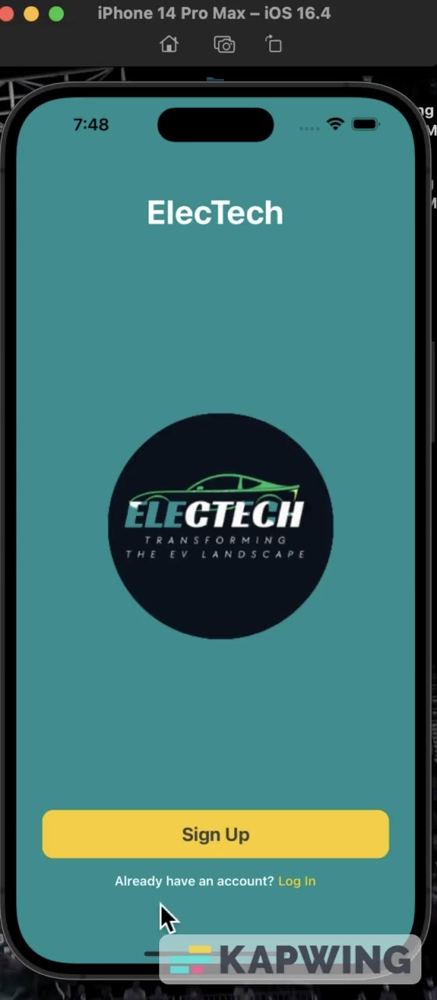
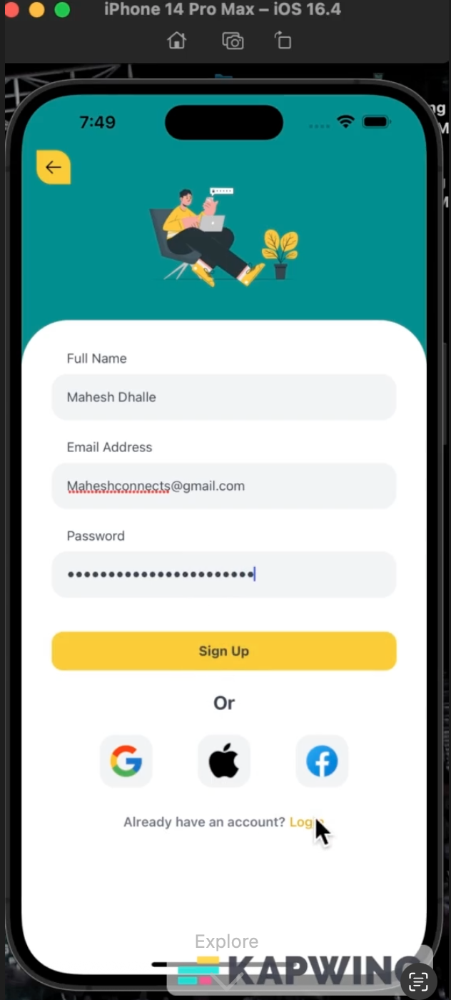
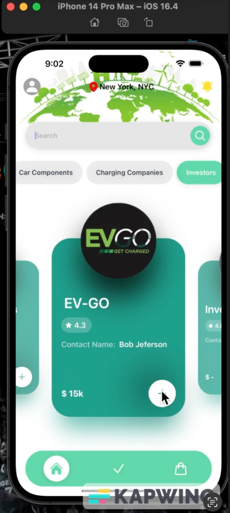
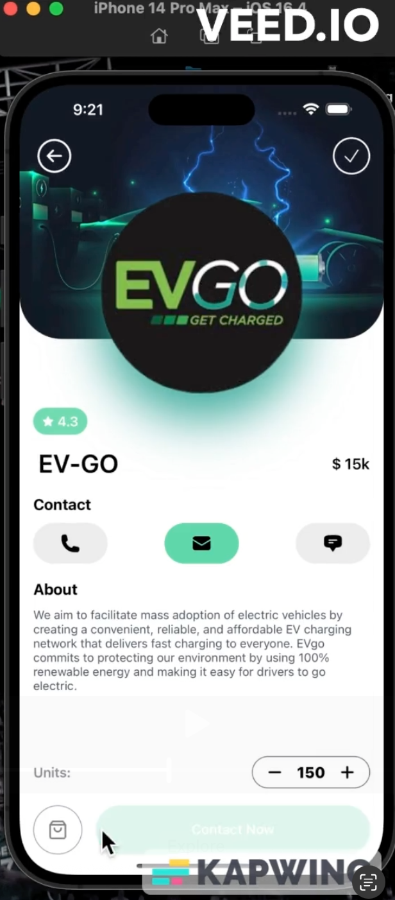
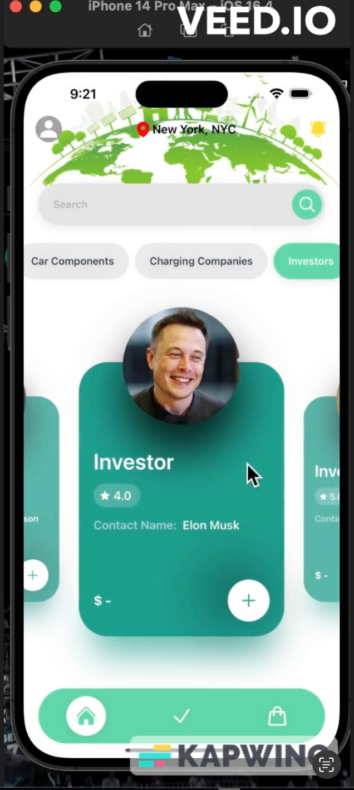
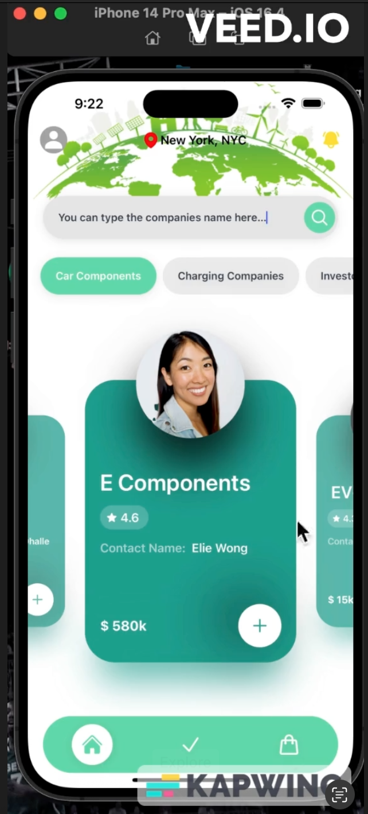

# Electech: EV Industry Marketplace App

A mobile app concept that connects three groups in the electric vehicle industry: car component makers, charging companies and investors. Built with React Native and Expo.

## Screenshots

| Screenshot 1 | Screenshot 2 | Screenshot 3 |
|--------------|--------------|--------------|
|  |  |  |

| Screenshot 4 | Screenshot 5 | Screenshot 6 |
|--------------|--------------|--------------|
|  |  |  |

## Features

- Home screen with category tabs: Car Components, Charging Companies, Investors.
- Search bar and a card for each company or investor, showing price, rating and contact name.
- Detail screen with an About section, rating and a Contact Now button.
- Bottom tab navigation and stack navigation between screens.
- Styling with NativeWind (Tailwind for React Native).

Company and investor entries are sample data stored in `constants/index.js`.

## Setup

```
git clone https://github.com/Sejal116/NAAS---ELECTECH---APP.git
cd NAAS---ELECTECH---APP
npm install
npx expo start
```

Scan the QR code with Expo Go on your phone.

## Project structure

```
App.js                  entry point
navigation/             stack and bottom-tab navigation
screens/                HomeScreen, ProductScreen
components/clientCard.js  reusable card component
constants/index.js      categories and sample company data
theme/                  colours
```

## Next steps

- Replace sample data with a real backend.
- Add working search and filtering by category.
- Add sign-in and a messaging flow behind the Contact button.
